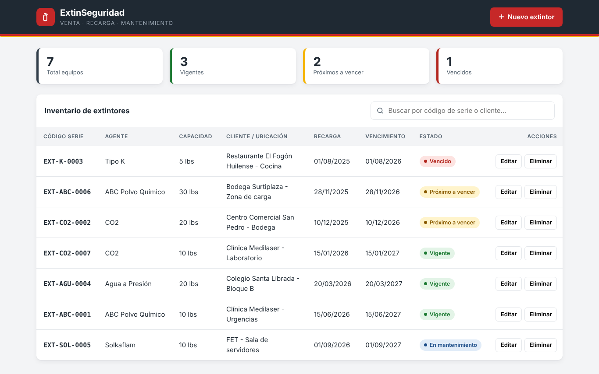
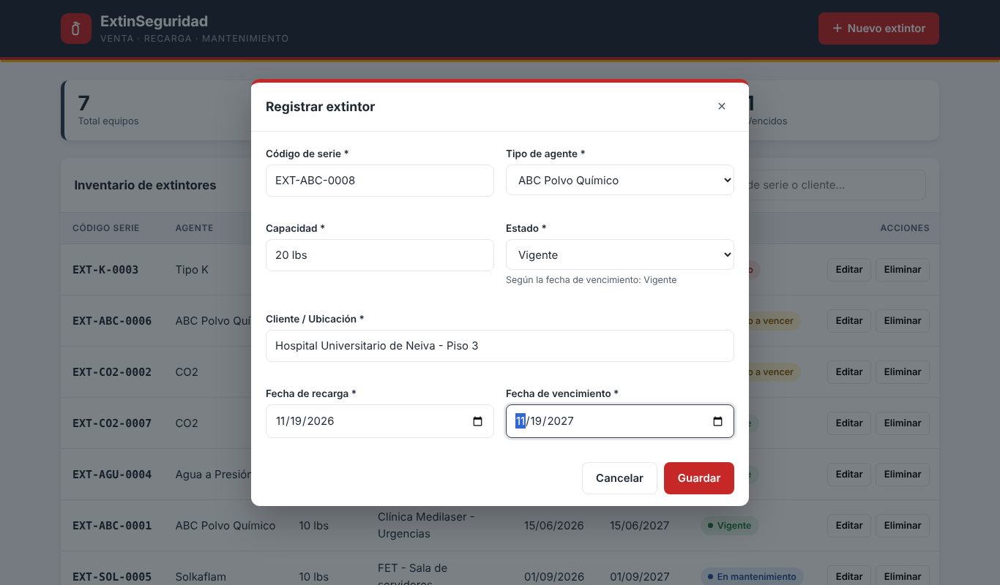
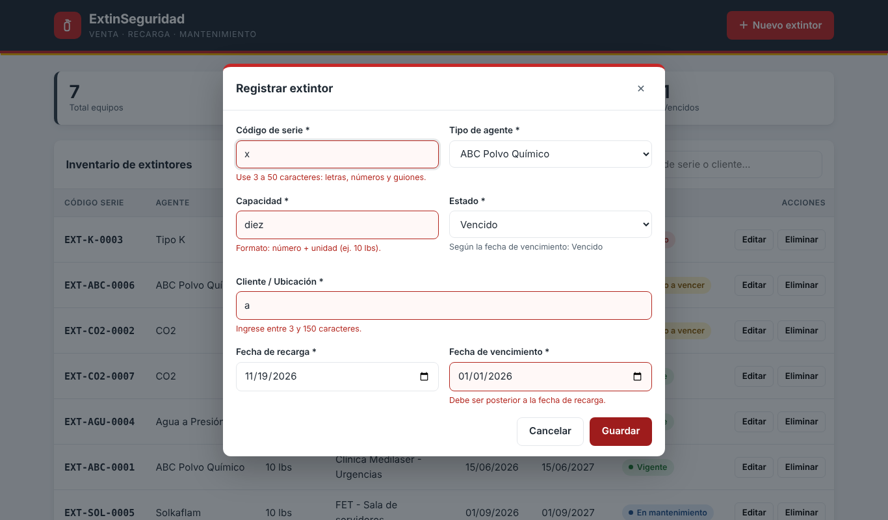
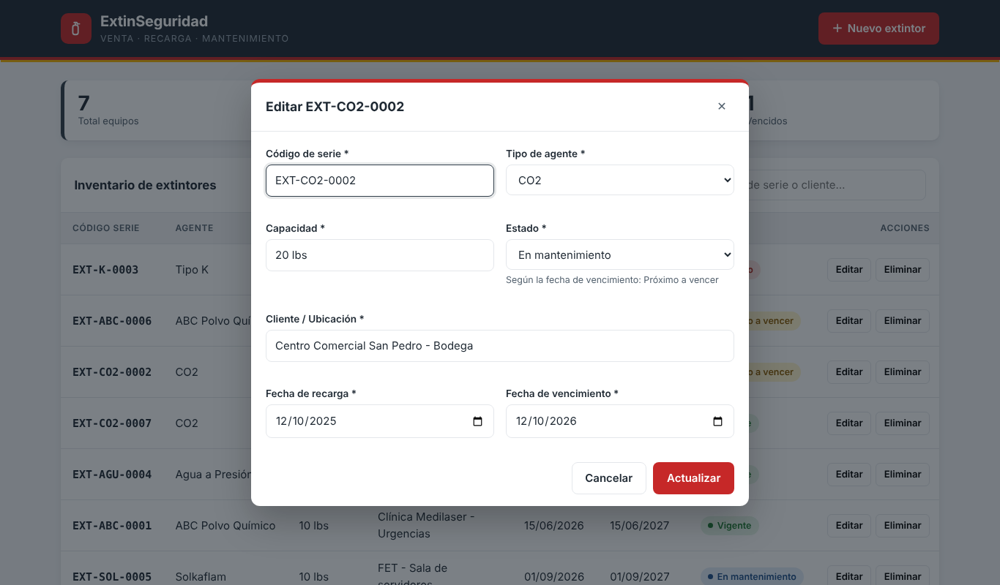
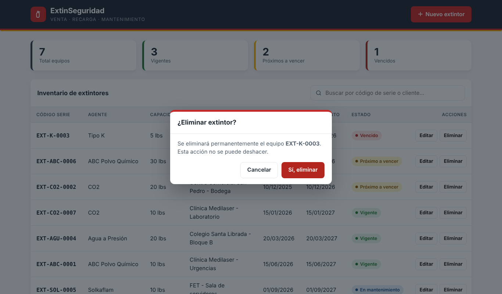
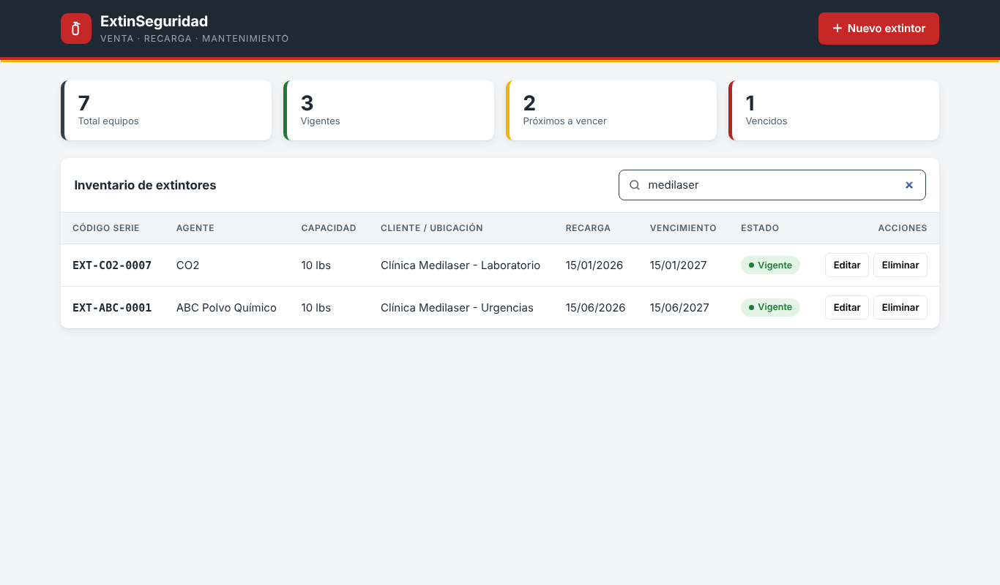
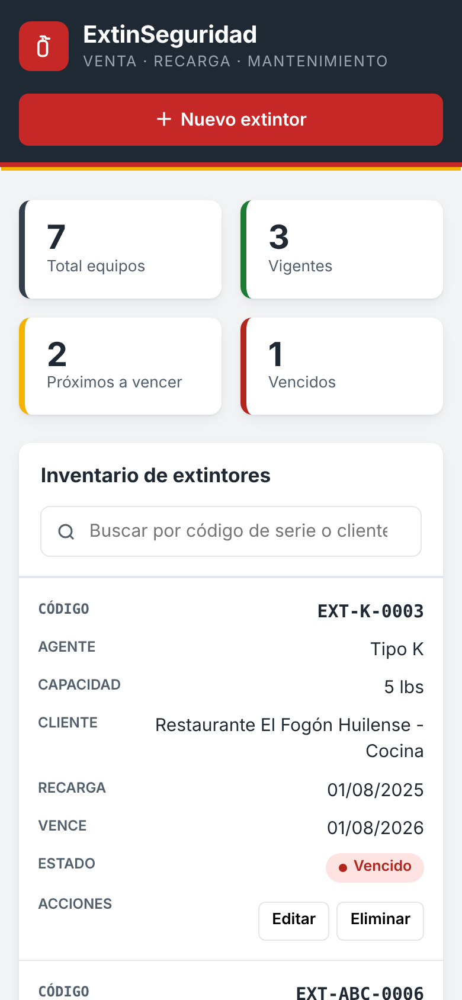

# 🧯 ExtinSeguridad · Sistema CRUD de Gestión de Extintores

## 📌 Descripción breve

**ExtinSeguridad** es una aplicación web para la gestión e inventario de un negocio de **venta, mantenimiento y recarga de extintores**. Permite registrar equipos, consultarlos en una tabla con buscador, editar sus fechas y estado, y eliminarlos con confirmación previa. Cada extintor muestra un indicador de color según su estado (🟢 Vigente, 🟡 Próximo a vencer, 🔴 Vencido, 🔵 En mantenimiento), y el panel superior resume cuántos equipos hay en cada estado.

El proyecto se desarrolló para el **Seminario en Gestión de Software Ágil Asistido por IA** de la Fundación Escuela Tecnológica de Neiva (FET), construyendo la aplicación a partir de prompts de inteligencia artificial.

---

## 🛠️ Tecnologías utilizadas

| Capa | Tecnología | Uso en el proyecto |
|------|------------|--------------------|
| Frontend | **HTML5** | Estructura de la interfaz, formularios y modales |
| Frontend | **CSS3** (Flexbox + Grid) | Diseño responsivo con paleta de seguridad industrial |
| Frontend | **JavaScript ES6+** (Fetch API) | Comunicación asíncrona con la API, validación y renderizado de la tabla |
| Backend | **PHP 8** (sin frameworks) | API REST con separación de responsabilidades (repositorio + validador) |
| Base de datos | **MySQL** con **PDO** | Persistencia con consultas preparadas contra inyección SQL |
| Servidor local | **XAMPP** / **Laragon** | Apache + MySQL para ejecutar el proyecto |

---

## 📁 Estructura del proyecto

```
crud_extintores/
├── api/
│   ├── _bootstrap.php          # Utilidades comunes: respuestas JSON, CSRF, validación de método e id
│   ├── crear.php               # POST   → Crear
│   ├── leer.php                # GET    → Leer (lista, búsqueda ?q= y detalle ?id=)
│   ├── actualizar.php          # PUT    → Actualizar (?id=)
│   └── eliminar.php            # DELETE → Eliminar (?id=)
├── config/
│   ├── conexion.php            # Conexión PDO (utf8mb4, excepciones, try-catch)
│   └── .htaccess               # Bloquea el acceso directo desde el navegador
├── src/
│   ├── ExtintorRepository.php  # Capa de datos: todas las consultas SQL preparadas
│   ├── ExtintorValidador.php   # Validación y sanitización en el servidor
│   └── .htaccess
├── docs/capturas/              # Capturas de pantalla del README
├── database.sql                # Crea la BD, la tabla y 3 registros de ejemplo
├── index.php                   # Vista principal
├── styles.css                  # Estilos responsivos
├── app.js                      # Lógica del frontend
└── README.md
```

---

## ▶️ Instrucciones para ejecutar el proyecto

### Requisitos
- PHP **8.1 o superior** con la extensión `pdo_mysql` (incluida en XAMPP y Laragon).
- MySQL 5.7+ o MariaDB 10.3+.

### Opción A · XAMPP

1. Clona o descarga el repositorio dentro de `C:\xampp\htdocs\`:
   ```bash
   cd C:\xampp\htdocs
   git clone https://github.com/santiagohernandezpl-ux/crud_extintores.git
   ```
2. Abre el **XAMPP Control Panel** e inicia **Apache** y **MySQL**.
3. Entra a `http://localhost/phpmyadmin` → pestaña **Importar** → selecciona `database.sql` → **Continuar**.
4. Abre en el navegador: `http://localhost/crud_extintores/`

### Opción B · Laragon

1. Copia el proyecto en `C:\laragon\www\`.
2. Pulsa **Start All**.
3. Importa la base de datos desde la terminal de Laragon:
   ```bash
   mysql -u root < database.sql
   ```
4. Abre `http://crud_extintores.test/` o `http://localhost/crud_extintores/`.

### Configurar credenciales (si tu MySQL tiene contraseña)

Edita las constantes en `config/conexion.php`:

```php
const DB_HOST = '127.0.0.1';
const DB_PORT = '3306';
const DB_USER = 'root';
const DB_PASS = '';
```

> ⚠️ Los archivos `index.php`, `api/`, `config/` y `src/` deben quedar en el mismo nivel dentro de `htdocs/crud_extintores/`. Si al descomprimir aparece una carpeta duplicada (`crud_extintores/crud_extintores/`), mueve el contenido un nivel arriba.

---

## 📸 Capturas de pantalla

### Vista principal con el inventario


### Formulario para registrar un extintor


### Validación de campos en el formulario


### Edición de un extintor


### Confirmación antes de eliminar


### Buscador por código de serie o cliente


### Vista en móvil


---

## 🤖 Prompts utilizados

A continuación se listan los prompts que se usaron con la IA para construir el proyecto, en el orden en que se hicieron.

### Prompt 1 · Generación del sistema CRUD completo

**Qué pedí:** el código completo del CRUD. En el prompt definí un rol para la IA (arquitecto de software senior y desarrollador full-stack), el contexto del negocio de extintores, el stack obligatorio, los campos de la tabla, los requisitos de cada operación (crear, leer, actualizar, eliminar), reglas de seguridad y diseño, y el formato de entrega en un `.zip` con una estructura de carpetas definida.

**Para qué:** obtener una base funcional y segura del proyecto en una sola entrega. Usé una estructura de prompt por secciones (rol, contexto, tarea, restricciones y formato de salida) para que la IA no omitiera requisitos como las consultas preparadas, la conexión PDO con `try-catch`, los badges de color por estado o el diseño responsivo.

<details>
<summary>Ver prompt completo</summary>

```
### 1. ROL
Actúa como un Arquitecto de Software Senior y Desarrollador Full-Stack experto en arquitectura
cliente-servidor, seguridad web en PHP (prevención de inyección SQL) y diseño de interfaces
modernas (UI/UX).

### 2. CONTEXTO
Estoy desarrollando una aplicación web que requiere implementar un sistema CRUD (Crear, Leer,
Actualizar y Eliminar) completo y funcional para la gestión e inventario de un negocio de venta,
mantenimiento y recarga de extintores. El stack tecnológico obligatorio es:
- Frontend: HTML5, CSS3 y JavaScript (ES6+ con Fetch API para comunicación asíncrona o
  formularios tradicionales).
- Backend: PHP 8+ puro (sin frameworks externos, aplicando arquitectura limpia o separación
  de responsabilidades).
- Base de datos: MySQL / SQL (usando PDO con consultas preparadas).

### 3. TAREA Y REQUISITOS FUNCIONALES
Desarrolla el código completo para este sistema CRUD de gestión de extintores cumpliendo con
los siguientes requerimientos:
1. Base de datos (SQL): Script .sql con la creación de la base de datos gestion_extintores y la
   tabla extintores con los siguientes campos:
   - id (INT, PRIMARY KEY, AUTO_INCREMENT)
   - codigo_serie (VARCHAR, único, identificador del equipo)
   - tipo_agente (ENUM o VARCHAR: ABC Polvo Químico, CO2, Agua a Presión, Solkaflam, Tipo K)
   - capacidad (VARCHAR: ej. 5 lbs, 10 lbs, 20 lbs)
   - cliente_ubicacion (VARCHAR: nombre del cliente o área asignada)
   - fecha_recarga (DATE)
   - fecha_vencimiento (DATE)
   - estado (ENUM o VARCHAR: Vigente, Próximo a vencer, Vencido, En mantenimiento)
2. Conexión segura: Archivo conexion.php utilizando PDO con manejo de excepciones (try-catch)
   y codificación utf8mb4.
3. Crear (Create): Formulario con validación frontend y backend para registrar nuevos
   extintores o servicios de recarga en MySQL.
4. Leer (Read): Consulta SELECT que liste todos los extintores en una tabla dinámica,
   incluyendo un buscador por código de serie o cliente, y resaltado visual (badges de color)
   según el estado (Vigente en verde, Próximo a vencer en amarillo, Vencido en rojo).
5. Actualizar (Update): Funcionalidad para cargar los datos de un extintor específico en el
   formulario (o modal), editar sus fechas/estado y ejecutar la sentencia UPDATE.
6. Eliminar (Delete): Opción para eliminar un registro mediante DELETE, solicitando
   confirmación previa al usuario en el frontend.

### 4. RESTRICCIONES Y REGLAS DE CALIDAD
- Seguridad: Es obligatorio usar Consultas Preparadas (Prepared Statements) en todas las
  operaciones SQL para evitar ataques de inyección SQL, además de sanitizar las entradas
  de usuario.
- Diseño: La interfaz en HTML y CSS debe ser responsiva (adaptable a móviles y escritorio) y
  visualmente limpia usando Flexbox o Grid, con una paleta profesional acorde al sector de
  seguridad industrial.
- Buenas prácticas: Código bien estructurado, comentado en puntos clave y sin funciones
  obsoletas de PHP (como mysql_*).

### 5. FORMATO DE SALIDA
Genera y entrega un archivo descargable comprimido (crud_extintores.rar o, si tu entorno no
soporta compresión RAR nativa, en crud_extintores.zip) que contenga toda la estructura de
carpetas y archivos del proyecto listos para usar:
- /config/conexion.php
- /api/ (endpoints para crear, leer, actualizar y eliminar)
- database.sql (con 3 registros de ejemplo incluidos)
- index.php
- styles.css
- app.js
- README.md (con la guía rápida de despliegue en XAMPP o Laragon)
Asegúrate de proporcionarme el enlace directo de descarga del paquete comprimido en tu respuesta.
```

</details>

### Prompt 2 · Corrección de la carpeta duplicada al descomprimir

**Qué pedí:**

```
Al descomprimir el paquete en C:\xampp\htdocs\, quedó una carpeta anidada
(htdocs/crud_extintores/crud_extintores/), por lo que al entrar a
http://localhost/crud_extintores/ Apache muestra el directorio Index of /crud_extintores en
lugar de cargar la aplicación directamente.

Por favor:
1. Indícame los pasos exactos en Windows para mover los archivos a la raíz correcta
   (htdocs/crud_extintores/) sin romper las rutas relativas de /config y /api.
2. Vuelve a generar el archivo descargable .zip asegurando que al extraerlo el contenido
   (index.php, config/, api/, etc.) quede en el primer nivel y no dentro de una subcarpeta
   duplicada.
```

**Para qué:** solucionar un error de despliegue. El `.zip` traía una carpeta interna y Windows creaba otra al extraer, por lo que Apache no encontraba el `index.php`. Pedí los pasos para corregirlo a mano y un nuevo paquete con los archivos en el primer nivel.

### Prompt 3 · Aplicar la corrección directamente en el equipo

**Qué pedí:**

```
modifica la que ya esta
```

**Para qué:** que la IA corrigiera la carpeta que ya tenía instalada en `C:\xampp\htdocs\crud_extintores\` en lugar de volver a descargar y extraer el paquete. La IA ubicó los archivos en la raíz correcta y solo quedó por borrar manualmente la subcarpeta vacía.

### Prompt 4 · Documentación del repositorio

**Qué pedí:**

```
HAZ EL README DE ESTA MANERA PORFAVOR Repositorio de GitHub
Un repositorio con todo el código fuente y un archivo README.md que incluya:
* Nombre del proyecto
* Descripción breve
* Tecnologías utilizadas (por ejemplo, HTML, CSS, JavaScript, Node.js, React)
* Instrucciones para ejecutar el proyecto
* Capturas de pantalla
* Lista de los prompts que usaste, cada uno con su explicación (qué pediste y para qué)
```

**Para qué:** dejar el `README.md` con el formato que pide la entrega del seminario, de modo que cualquier persona pueda entender el proyecto, ejecutarlo y ver cómo se construyó con IA.

---

## 🔐 Seguridad aplicada

- **Consultas preparadas** con parámetros nombrados en todas las sentencias SQL y `PDO::ATTR_EMULATE_PREPARES = false`.
- Escape de los comodines `%` y `_` en el buscador para evitar inyecciones en `LIKE`.
- **Validación doble:** en el navegador (`app.js`) y en el servidor (`ExtintorValidador.php`), con listas blancas para tipo de agente y estado, y la regla *vencimiento posterior a la recarga*.
- **Sanitización** de entradas con `strip_tags`, eliminación de caracteres de control y `trim`.
- **Protección XSS:** los datos se pintan con `textContent`, nunca con `innerHTML`.
- **Token CSRF** en las operaciones de crear, actualizar y eliminar.
- Restricción `UNIQUE` en `codigo_serie` y respuesta HTTP 409 si el código ya existe.
- Los errores de base de datos se registran en el log del servidor y no se muestran al usuario.

---

## 👤 Autor

** Santiago Hernandez Plza** · santiago_hernandezpl@fet.edu.co
Ingeniería de Software · Fundación Escuela Tecnológica de Neiva (FET)
Seminario en Gestión de Software Ágil Asistido por IA · Docente: Camilo Vargas
